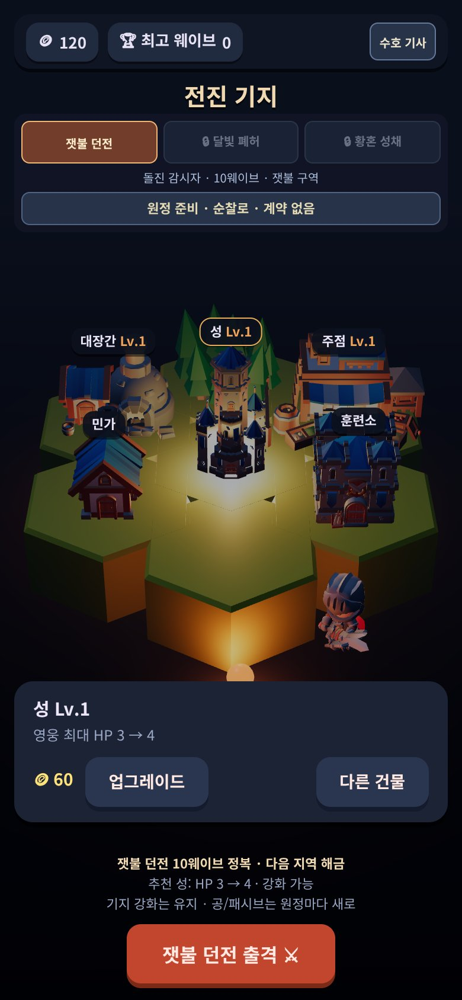
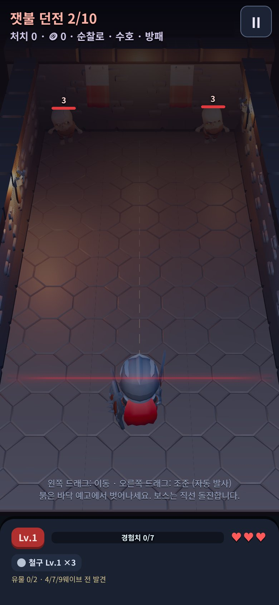
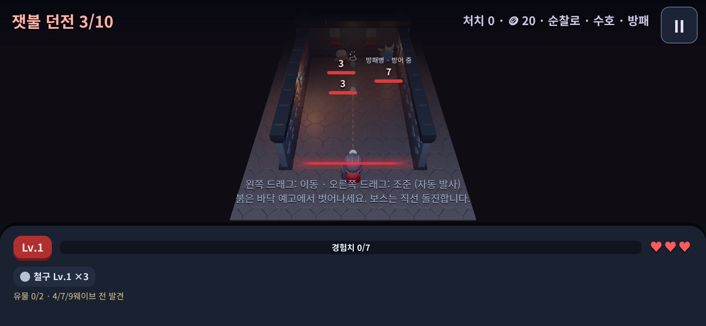

# bounce-knight (working title / 임시 작업명)

모바일 우선 3D 공 튕기기 로그라이트 (BALL x PIT 스타일 오마주, 오리지널 구현).

기사를 움직여 조준하고, 자동 발사되는 공을 튕겨 행진하는 적을 무찌르세요.
처치 → XP 젬 수집 → 레벨업 4장 중 하나 선택(새 속성 공 2장 / 강화 또는 융합 1장 / 패시브 1장) → 기지 건물 업그레이드로 성장.

## 화면
| 기지 (세로) | 전투 (세로) | 전투 (가로) |
| --- | --- | --- |
|  |  |  |

## 플레이
- 왼쪽을 누른 자리가 이동 스틱의 기준점, 오른쪽을 누른 자리가 조준 스틱의 기준점입니다. 누른 채 원하는 방향으로 드래그하세요. 공은 자동 발사됩니다.
- 파랑 `이동` / 주황 `조준` 스틱으로 역할을 표시합니다. 손가락이 중앙선을 넘어가도 누른 순간의 역할은 유지됩니다. 같은 역할에 두 번째 손가락을 대도 기존 조작을 빼앗지 않습니다.
- 작은 손떨림은 무시합니다(12px 데드존). 이동 손가락을 놓으면 정지하고, 조준 손가락을 놓으면 마지막 방향을 유지합니다.
- 오른쪽 위 `Ⅱ` 버튼 또는 Esc: 일시정지. `계속하기`로 재개합니다.
- 탭/앱을 벗어나 페이지가 숨겨지면 전투를 정지합니다. 돌아온 뒤 직접 계속하기를 눌러야 합니다.
- 정지 화면에서 소리를 끄거나 켤 수 있습니다. 선택은 이 배포 origin의 별도 설정에 기억합니다.
- OS/브라우저의 '동작 줄이기'를 사용하면 카메라 흔들림과 전체 섬광을 끄고 UI의 이동을 줄입니다. 공/적의 이동과 국소 타격 효과는 유지합니다.
- 기지: 성(영웅 HP), 대장간(공 직격 피해량), 주점(출격 공 수) 업그레이드
- 진행은 브라우저 localStorage에 저장됩니다 (이 배포 origin 기준).
- 저장을 읽거나 쓸 수 없는 경우 원본을 덮어쓰지 않고 임시 플레이임을 안내합니다. 임시 진행은 새로고침/기지 복귀 시 사라질 수 있습니다.
- 이전 공유 키의 저장은 자동으로 가져오거나 삭제하지 않습니다.

## 첫 실행과 연결 문제
- 첫 HTML 화면부터 게임 이름과 회전 표시, `불러오는 중…` 안내가 보입니다.
- 기본 UI를 먼저 표시하고 기지 모델은 병렬로 준비합니다. `기지 모델 준비 중… n/10`은 다운로드 바이트 비율이 아니라 준비를 마친 모델 종류 수입니다.
- 준비 전에도 지역·기사·원정 선택과 출격을 할 수 있습니다. 건물 강화는 모델 준비가 끝난 뒤 사용할 수 있습니다.
- 모델 요청이 실패하거나 60초간 끝나지 않으면 연결 확인과 `다시 불러오기`를 안내합니다. 저장 원본을 삭제하지 않습니다.
- 첫 방문은 3D 자원 다운로드로 오래 걸릴 수 있습니다. 네트워크에 따라 전체 완료 시간은 달라집니다.

## 다음 원정 목표
- 기지에서 선택한 지역의 10웨이브 정복 목표와 낮은 레벨 건물의 강화 제안을 보여줍니다. 성/대장간/주점이 같은 레벨이면 이 순서입니다. 추천은 자동 구매가 아닙니다.
- 종료 화면에서 귀환 후 골드·강화 비용·부족분과 다음 목표를 미리 봅니다. 임시 플레이는 저장/귀환 초기화 안내로 대체됩니다.
- 기지 강화는 다음 원정에도 유지되고, 공·레벨업 패시브는 그 원정에서만 유지됩니다.

## 적과 보스
- 해골: 기본 전진. 도적: 좌우로 움직여 조준을 흔듭니다.
- 마법사: 보라색 원에 1.2초 뒤 지면 공격. 표시된 위치를 벗어나면 피합니다.
- 중장갑 전사: 느리지만 위험선 돌파 피해 2.
- 잿불 던전의 돌진 감시자: 붉은 구역과 '돌진 준비' 표시 뒤 전진. 표시 중 옆으로 피하고 공격 기회를 잡으세요. 동결 중에는 예고 시간도 멈춥니다.

## 세 지역 원정
- 잿불 던전 → 달빛 폐허 → 황혼 성채를 각각 10웨이브로 정복합니다. 보스를 처치하고 귀환하면 다음 지역이 열립니다. 보스가 영웅에게 닿거나 위험선을 넘으면 원정은 실패로 끝나며 지역은 해금되지 않습니다.
- 폐허 소환사는 주기적으로 부하를 부릅니다. 성채 군주는 체력 절반부터 더 짧은 돌진 예고와 잦은 봉쇄선을 사용합니다.
- 3웨이브부터 던전의 잿불 원, 폐허의 낙인, 성채의 가로 봉쇄선이 영웅 위치에 고정됩니다. 1.6초 예고 후 해당 구역에 남으면 HP 1을 잃습니다. 예고 중 벗어나세요. 정지/선택 중 시간도 멈춥니다.
- 정복한 지역도 다시 출격할 수 있습니다. 새 공이나 기지 강화는 정복과 별개의 성장입니다. 기존 저장의 골드/건물/최고 웨이브는 유지하고 지역 진행만 추가합니다.

## 원정 선택 이벤트
- 3웨이브 전 보물상자: 안전한 골드20 또는 골드45와 남은 원정 적HP+20%를 고릅니다.
- 6웨이브 전 저주 제단: HP1 회복 또는 HP1을 지불하고 남은 원정 직격 배율+0.4. HP가1이면 저주를 선택할 수 없습니다.
- 8웨이브 전 갈림길: HP2 회복 또는 첫 보유 공 레벨+1. 회복은 성의 최대HP까지만 적용되며 이미 그보다 높은HP를 줄이지 않습니다.
- 각 이벤트는 한 번만 등장하고 하나만 고릅니다. 전투·위험 예고·공·적은 선택 중 멈춥니다. 보상/위험과 공 강화는 그 원정에만 적용되고, 골드는 귀환 시 저장됩니다.

## 공 조합
- 빙결 → 철구: 동결을 소모하고 쇄빙 추가 피해 2 (강철구 4).
- 독 → 화염: 중독을 소모하고 남은 독의 최대 1초분을 즉시 피해로 전환 (올림, 최소 1). 남은 전체 지속 피해를 모두 보장하는 선택은 아닙니다.
- 연계 추가 피해에는 공격 태세·대장간의 직격 배율이 붙지 않습니다. 빙결 유지/지속 독과 즉시 피해 중 어떤 것을 택할지 조합에 따라 달라집니다.

## 새 공과 이종 융합
- 바람구는 적을 뒤로0.45(진화0.85), 중력구는 반경2(진화2.7)의 다른 적을 적중점 쪽으로 최대0.4(진화0.75)만큼 이동시킵니다. 보스도 대상이며 위험선 너머로 밀거나 경기장 좌우 경계를 벗어나지 않습니다.
- 관통구는 적에게 반사되지 않으며 한 번 발사한 공으로 같은 적을 다시 때리지 않습니다. 벽 반사는 유지됩니다.
- 화염+바람=화염 폭풍구, 빙결+중력=서리 중력구, 번개+관통=뇌전 관통구, 독+바람=맹독 돌풍구. 두 효과를 함께 사용하며 기본 직격은2+레벨×2입니다.
- 이종 융합은 진화/융합 전 공2개를 소비하고 낮은 쪽 레벨의 새 공1개를 만듭니다. 같은 속성/같은 레벨2개 진화는 유지됩니다. 둘 다 가능하면 레벨별로 교대해 성장 카드에 제시합니다. 결과는 카드에서 미리 봅니다.
- 이종 융합 공은 다시 융합하지 않지만 레벨 강화할 수 있습니다. 새 속성 카드에는 기존4종과 새3종 중 서로 다른2종이 나옵니다.

## 출격 기사
- 기지 우측 상단의 기사 버튼에서 선택하며 선택은 현재 저장에 기억합니다. 기존 저장은 수호 기사부터 시작합니다. 새 기사에 골드를 쓰지 않습니다.
- 수호 기사: 철구3개로 시작. 원정의 첫 피격에서 피해1을 줄입니다. 첫1피해는 막고, 첫3피해는2로 줄입니다. 다음 피격에는 방패가 없습니다.
- 유성 기사: 잿불 던전 정복 후 해금. 관통구1+철구2로 시작하고 모든 공 속도가20% 빠릅니다. 발사 간격은 그대로입니다.
- 연금 기사: 달빛 폐허 정복 후 해금. 독구/빙결구/철구로 시작하고 독/빙결 시간이30% 길어집니다. 독의 초당 피해는 그대로이므로 전체 지속 피해도30% 늘어납니다.
- 주점의 추가 공은 기사 선택과 무관하게 철구로 더해집니다. 기사는 같은 기존 모델을 재사용하며 시작 공/능력/화면 이름으로 구분합니다.

## 반복 원정: 조건·계약·유물
- 기지의 `원정 준비`에서 조건 하나와 계약 하나를 고릅니다. 골드/외부 결제 비용은 없으며 조건과 계약 선택은 저장됩니다.
- 순찰로는 기존 구성입니다. 정예 습격은 적HP35% 증가/4·7웨이브 중장갑 증원/적 처치 골드50% 증가, 황금 행렬은 적 전진20% 증가/적 처치 골드2배입니다. 배율은 적 처치 골드에만 적용하고 웨이브 보너스/이벤트/계약 골드는 바꾸지 않습니다.
- 토벌 의뢰는10처치/35골드, 보석 회수는10젬/40골드, 수문장 사냥은보스격파/60골드입니다. 계약을 고르지 않아도 됩니다. 조건을 실제로 달성한 원정의 종료 시 한 번만 보상하며 결과의 획득 골드에 포함됩니다. 미달성은 보상0입니다.
- 4·7·9웨이브 전에6종 중 무작위3종의 유물을 발견합니다. 보유 중인 유물은 후보에서 빼고 하나만 고르거나 지나갈 수 있습니다. 최대2개를 보유하며 세 번째 획득은 기존 하나를 골라 교체해야 합니다. 발견 선택 중 전투 시간은 멈춥니다.
- 청록 나침반: 젬 자석 거리4.2. 메아리 인장: 실제 벽 반사마다 해당 발사체 직격+1(최대3), 회수 시 초기화. 호박 부적: 보유 중 다음 피격1 방어, 원정당1회로 재장착해도 재충전하지 않습니다.
- 시계 톱니: 보유 중 발사 대기시간15% 감소. 탐욕 주머니: 적 처치골드 배율 후+2. 진홍 성배: 보유 중5처치마다 최대HP까지1회복. 교체한 유물 효과는 즉시 없어집니다.
- 원정 유물은 귀환 때 사라집니다. 실제 획득한 종류만 귀환 시 도감에 중복 없이 기록되어 `원정 준비`에서 확인할 수 있습니다. 도감은 영구 전투 강화가 아닙니다. 임시 플레이는 기존과 같이 저장하지 않습니다.

## 검증 범위와 한계
- 브라우저의 모바일 크기 화면과 실제 포인터 입력으로 확인합니다. 휴대폰 실기기/OS의 전화 수신 동작까지 검증했다는 뜻은 아닙니다.
- 자동 입력 정책으로 정상 URL의 1·2지역 보스 처치와 귀환/영구 강화/재도전을 확인했습니다(이전 절대좌표 조작판). 3지역 보스 처치와 새 상대드래그 조작으로 전 캠페인 완주는 미확인입니다.
- 새 상대드래그는 합성 포인터 이벤트로 이동·조준 분리, 동시 입력, 해제·취소·정지 복귀를 확인했습니다. 실제 휴대폰의 모든 터치 상황을 보장하는 검사는 아닙니다.
- 정상 URL의 짧은 플레이와 강제 상태 검사를 구분합니다. `?probe`는 개발 검사용 상태 노출 경로이며 일반 플레이 결과로 취급하지 않습니다.
- 로딩 실패 후 재시도, 저장 실패 원본 보존, 4장 선택, 보스 보상, 정지/재개, 키보드 포커스, 효과 만료를 검사합니다.
- 효과음 노드 생성/무음/연결 정리 검사와 실제 청감 검증은 다릅니다. 모든 기기의 음질이나 성능을 보장하지 않습니다.
- 프레임 속도는 렌더링 환경에 따라 달라집니다. 반복 가능한 같은 장면에서 측정하지 않은 FPS 수치는 제공하지 않습니다.

## 로컬 실행
정적 파일만 있습니다. 아무 정적 서버나 루트에서 서빙하세요:
`python3 -m http.server` → http://localhost:8000

## 사용 에셋 / 라이선스
- 코드: MIT (이 저장소)
- KayKit 3D assets (kaylousberg.itch.io) — CC0
- plinkfx (github.com/sigco3111/plinkfx) — 코드 MIT, 사운드 CC0 (합성 효과음으로 대체 사용)
- three.js — MIT

제목은 아직 임시 작업명입니다.

### 우선순위를 바꾸는 적
- 3웨이브 방패병: 2초 방어/1.5초 빈틈 순환. 방어 중 정면 직격 -1(최소0). 후면 반사·관통구로 우회, 동결 중 방패 비활성. 상태·연쇄·범위 피해는 방패가 막지 않습니다.
- 5웨이브 치유 사제: 4초마다 반경2 내 다른 적 HP+1, 각 최대 HP까지. 자신·먼 적 회복 안 함. 동결 중 회복 시계 정지.
- 7웨이브 폭발 운반병: 처치 시1.5초 예고 후 반경1.1 내 영웅 피해1. 접촉/경계 이탈 시 폭발 없음. 선택·일시정지 중 폭발 시계 정지, 원정 종료 시 경고 제거.
- 위 출현은 해당 웨이브 첫 적을 대체하므로 기존 적 수를 무작정 더하지 않습니다. 원정 준비의 적 정보에서 대응법 확인. 새 저장 필드·외부 모델·권한 추가 없음.
